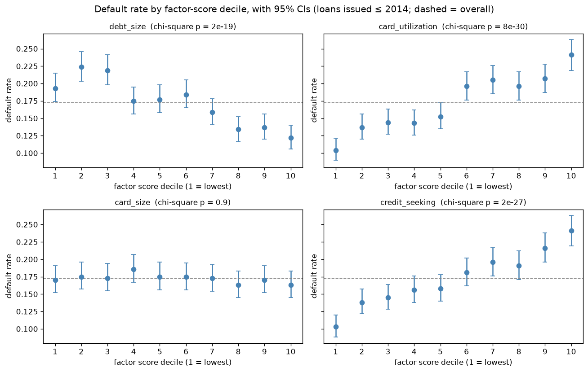

# Findings: Credit Risk Data (Part A)

Data: 30,000 approved loans issued 2013–2015 (applications, credit bureau, servicing) and 5,000 holdout applications from 2016. Every rule, statistic and model in this report was fitted on loans issued on or before **2014-12-31** (14,373 loans) and applied unchanged to later loans.

---

## Summary for the credit team

**1. The data needed repair, and one column was cheating.** About 3,000 records contained errors: loan amounts recorded ten times too large, incomes entered in thousands, utilization with a flipped sign, swapped FICO bounds, impossible dates and duplicate applications. Each error was proven with independent evidence and fixed by a rule that also runs automatically on new applications. One bureau column (`bureau_recovery_flag`) records money recovered *after* a default; it identifies every defaulter in the data, cannot exist when a customer applies, and has been removed.

**2. Default is common, and long loans are twice as risky.** 18.7% of loans defaulted. Among 2013–14 loans, 13.2% of 36-month loans defaulted against 28.3% of 60-month loans.

**3. Most loan groups lose money on average.** A repaid loan earns 10% and a defaulted one loses 70%, so a group only makes money if fewer than 12.5% of its borrowers default. Only grades A (4.5%) and B (10.8%) are clearly below that line; grades C to G are above it, and even the average 36-month loan sits just above it (12.6–13.9%). Approving or declining whole groups does not work: the value lies in finding the good borrowers inside the risky groups, which is the job of the model.

**4. Four borrower profiles explain much of the risk.**

| Profile | What it captures | Effect on default |
| --- | --- | --- |
| Card utilization | How maxed out the credit cards are | 10% for the lowest tenth of borrowers, 24% for the highest |
| Credit-seeking | How many new accounts were opened recently | 10% → 24% |
| Debt size | Established borrowers with mortgages, high limits and income | 22% → 12% (bigger is safer) |
| Card size | How large the card limits are | No effect |

**5. Bureau data can be trusted; stated income cannot.** Balances and account counts come from bureau records and are exact. Income is typed by the applicant: 84% of incomes are round thousands, verification does not change that, and one "verified" sales representative reports $7.5M a year. Verified loans default more (19.1% vs 12.7%) because the platform chose to verify larger, riskier applications, not because verification makes borrowers worse.

**6. The borrower population is stable.** All model inputs keep the same distribution from 2013 to 2014 and into 2015. One field, the job title, changed meaning in late 2013 (employer names became job titles) and was dropped.

**7. Limits to keep in mind.**
- The data contains only *approved* loans (FICO 662 and above, debt-to-income below 40). The findings and the model apply to applicants inside those limits; others, and all joint applications, should go to manual review.
- Location is not used, because it can act as a stand-in for protected characteristics and added almost no predictive value. The data has no protected attributes, so indirect discrimination cannot be tested here; a production model would need a fairness audit.

**What this means for decisions:** use a model that scores each applicant individually, with thresholds tied to the 12.5% break-even rate, and send applicants outside the approval policy's range to manual review.

---

## Technical appendix

### A1. Data audit (issue log: `reports/audit_issues.csv`)

| File / field | Issue | Rows | Action | Evidence |
| --- | --- | --- | --- | --- |
| applications.id | Duplicate ids (copies differ only in emp_title case and dti ±0.01) | 600 | Drop (keep first) | Label and amounts never differ |
| issue_d, earliest_cr_line | Three date formats | 1,200 each | Parse each format explicitly, month precision | All parse; ISO dates are day 01; no day/month swaps |
| addr_state | Full names / lower-case codes | 1,963 | Standardize to two-letter codes | 0 unrecognized |
| loan_amnt | Recorded ×10 (280 above 40,000, 20 within range) | 300 | ÷10 + flag | Installment exactly 1/10 of the amortization payment; servicing principal repaid = corrected amount (243 paid loans) |
| annual_inc | Entered in thousands (< 1,000) | 899 | ×1,000 + flag | Raw values make payments exceed income in 100% of rows; clean gap 470 → 7,500 |
| revol_util | Sign flipped | 295 | Absolute value + flag | Agrees with balance ÷ limit as often as normal rows (97.3% vs 96.1%) |
| bc_util | Sign flipped (different loans) | 290 | Absolute value + flag | Median 68 vs 67; correlation with revol_util 0.835 vs 0.834 (−0.835 raw) |
| fico_range_low / high | Swapped | 150 | Swap + flag | low − high = 4 in all 150, mirroring the normal +4 |
| earliest_cr_line | After issue date (1–23 months) | 300 | Set missing + flag; imputed in A4 | No constant shift; normal account counts (median 24) |
| installment / int_rate | Inconsistent, not ×10 | 11 | Flag, keep | 8 have a rate > 2 pts from their sub-grade's usual rate |
| zip_code / addr_state | ZIP region ≠ state | 27 | Flag, keep | Similar rate in untouched holdout (3) |
| dti | Above 40 | 4 | Keep (genuine joint applications) | Holdout has 41, incl. individuals: drift |
| bureau_recovery_flag | Post-default information | 4,207 | **Exclude (leakage)** | 100% default when 1; equals servicing `recoveries > 0` exactly; all 0 in holdout |
| title | Duplicates purpose | all | Exclude | 63% identical to purpose |
| Label vs servicing | Consistency check | 1 | Keep | Paid loans repaid full principal; settled loans all defaulted |

The holdout contains none of the planted errors; the rules stay in the transform as safeguards. Joint applications rise from 16 (training) to 96 (holdout).

### A2. Target

- Overall default rate 18.7% (5,617 / 30,000); 36-month 14.0%, 60-month 32.3%. Chart: `reports/default_rate_by_month.png`.
- **In-progress bias:** data ends March 2019, so a 60-month loan issued in 2014 or later could not have reached its end; only early outcomes (mostly defaults and early payoffs) are observed. Share of 60-month loans still at risk at the cut-off: 0% (2013), 78% (2014), 100% (2015). The 60-month default rate is 24.7% on loans that could have finished vs 34.9% including the biased ones. Absolute default rates of recent 60-month loans are overstated; rankings and comparisons are less affected.

### A3. Financial values and outliers

- Money fields are right-skewed across orders of magnitude (annual_inc skew 63.3); ratios and policy-bounded amounts are not. Plots: `reports/financial_linear_vs_log.png`.
- **Mean ± 3 SD is not a sound rule here:** the outliers inflate the SD that defines them (removing one $7.5M income cuts the SD from 76,973 to 45,695 and moves the limit from $305k to $211k), and the lower limit is a negative income (−$156,545). The IQR fence flags 428–829 normal borrowers per money field.
- **Errors vs genuine extremes:** errors were fixed in A1. Genuine extremes were verified, e.g. revol_util 366.6% = $2,566 owed on a $700 limit (recomputation agrees within 5 pts for 96.2% of loans). Suspected but unprovable errors ($7.5M and $1.25M incomes imply DTI 20 / 18.2 at 100× / 10× lower income) are capped, not corrected.
- **Chosen method (fitted ≤ 2014):**

| Fields | Treatment | Caps |
| --- | --- | --- |
| annual_inc, revol_bal, tot_cur_bal, avg_cur_bal, tot_hi_cred_lim, total_rev_hi_lim | cap at p99.5, then log1p | 300,000; 176,561; 755,791; 85,142; 869,472; 184,670 |
| dti, revol_util, bc_util | cap at the IQR fence | 40.95; 125; 150 |
| loan_amnt, installment | none (bounded by lending policy) | — |

- **Effect:** under 0.5% of values changed; annual_inc skew 63.33 → 0.09; ranking unchanged (default rate by decile identical before and after). Capped loans stay separable at the cap; the largest balances default less (4–7% vs 11–14% in the rest of the top decile).
- **Zeros:** zero balances and utilizations form separate groups (revol_bal 40, revol_util 49, bc_util 115) and are kept as values, not treated as missing.

### A4. Reliability, missingness, leakage, features

- **Missingness** (default rate with vs without the value; no gap exceeds noise), treated by cause:

| Field | Missing | Cause | Treatment |
| --- | --- | --- | --- |
| mths_since_last_delinq | 46% | Never delinquent | Flag `ever_delinq`; kept missing (own WoE bin) |
| emp_title / emp_length | ~5% | Same applicants (685 of 686) | Not used as features (see A5, A7) |
| bc_util | 1.1% | Likely no bankcard; stable rate across years | Flag + median 69.4 |
| earliest_cr_dt | 300 (A1) | Impossible dates | Median history of its total_acc quintile (139–210 months), at least months since last delinquency; 5 groups chosen by out-of-time error (MAE 68.7 → 65.7) |
| revol_util | 4 | Two have no revolving credit | Recomputed from balance ÷ limit; 0 when no credit |

- **Reliability:** high for platform and bureau fields (installment formula matches 99.96%; bureau balances 0.1% round thousands); medium for home_ownership, dti, verification_status, purpose; low for annual_inc, emp_title, emp_length. Installment never exceeds 40% of monthly income (median 7.7%); implied dti debt rises with card balance (Spearman 0.521). dti is computed from stated income, so it cannot reveal an inflated income.
- **Leakage:** single-feature AUC scan; bureau_recovery_flag 0.906 vs ≤ 0.681 for all others.
- **Old-model pricing excluded:** grade, sub_grade, int_rate and installment (installment ÷ amount ranks loans like int_rate: Spearman 0.9997 / 0.9990 within 36 / 60-month terms). Our model must assess risk independently; the Part B ablation measures what they would add.
- **Features built:** credit_hist_months, fico_mid, loan_to_income (AUC 0.591, beats loan_amnt 0.538 and income 0.552), ever_delinq, bc_util_missing. Rejected with evidence: installment_to_income (carries int_rate), principal_per_year_to_income (AUC 0.532), revol_bal_zero (redundant).

### A5. Categories and WoE / IV

- Minimum group size **100 loans** (rate accurate to about ±8 pts). purpose: moving, vacation, house, wedding, renewable_energy → "other" (8 groups). Verified and Source Verified merged (WoE −0.138 vs −0.118; IV 0.0458 → 0.0457). home_ownership kept (3 levels, all ≥ 1,406 loans).
- emp_title grouped into 10 job families by ordered keyword rules (15 test titles pass; 65.5% matched). Later excluded (A7).
- **IV ranking** (10 bins): sub_grade 0.503 (too good to be true: it is the old risk model), grade 0.454, int_rate 0.451; honest features at most medium: term 0.195, fico_mid 0.108, loan_to_income 0.101. Delinquency and public-record fields ≤ 0.004 (accepted-only selection, A7).
- **Purpose risk levels for the scorecard:** high (small_business 30%), medium (debt consolidation, other, medical ~18%), low (credit card, home improvement, major purchase, car ~15%). Chi-square inside levels p = 0.855 / 0.942, between p = 4e-10; out-of-time AUC with frozen 2013–14 WoE 0.5415 vs 0.5443 for 8 groups (within noise).
- **Out-of-time test** (WoE learned 2013–14, AUC on 2015; rule < 0.53 → exclude): emp_length 0.5076 → excluded.

### A6. Correlation, PCA and factor analysis

- **Input:** 19 treated numeric features, standardized on ≤ 2014. log1p on 6 count fields whose raw max |z| exceeded 5 (e.g. num_tl_op_past_12m 11.5 → 3.8). delinq_2yrs, pub_rec, pub_rec_bankruptcies excluded (80–88% zeros).
- **Correlation (Spearman)** shows five blocks: debt size (0.90–0.98), card utilization (0.81), card size (0.78), credit-seeking (0.71), account count (0.67). **VIF:** tot_cur_bal 212, avg_cur_bal 168.5 (balance ÷ accounts), tot_hi_cred_lim 25, open_acc 24.6; loan / income / loan_to_income 6.6–8.0. This redundancy is why dimension reduction is useful, and why the scorecard keeps only one field per redundant pair.
- **PCA:** PC1 27.2%, PC2 14.2%, PC3 11.5%, PC4 10.2%. Elbow → 4 components (63%); Kaiser → 6, but PC6–PC7 are single-column leftovers. Components: credit size; existing-card use vs new accounts; credit stress; size of the request. Scree: `reports/pca_scree.png`.
- **Effect of the outlier treatment:** untreated PCA has the same components (direction similarity 0.99 / 0.92 / 0.90) but PC1 explains less (23.2%) and income loads 0.43 instead of 0.67; the most extreme untreated value is 96.5 SD from the mean.
- **Factor analysis:** Bartlett p ≈ 0; KMO 0.661 → 0.724 after removing loan_to_income (a formula of loan ÷ income), with avg_cur_bal also removed (near-redundant). **4 factors, promax rotation:**

| Factor | Top loadings |
| --- | --- |
| Debt size | tot_cur_bal 0.96, tot_hi_cred_lim 0.95, mort_acc 0.75, annual_inc 0.62 |
| Card utilization | revol_util 0.94, bc_util 0.88, fico −0.56 |
| Card size | total_rev_hi_lim 0.94, revol_bal 0.79, open_acc 0.49 |
| Credit-seeking | acc_open_past_24mths 0.84, num_tl_op_past_12m 0.73, open_acc 0.48, total_acc 0.43 |

  Promax was chosen because debt size and card size correlate 0.56 (factor scores); varimax gives the same groups. A 5th factor (dti 0.64, income −0.54) mostly reflects the dti = debt ÷ income formula and was rejected. No Heywood case (unrotated communalities ≤ 0.97). The factor-correlation matrix returned by `factor_analyzer` lists factors in a different order than its loadings; this was verified and corrected.
- **FA vs PCA:** PCA compresses all variation into uncorrelated directions and suits a compact input for a model. Factor analysis models only the variation fields share and yields traits that can be named and explained, which matters here: the credit team must explain decisions, and named traits translate into reason codes. Rotation also separated card use from new-account activity, which PCA bundled into one contrast.

### A7. Stability and risk insights

- **PSI 2013 vs 2014:** every model input and factor score < 0.10 (largest 0.048). 2013–14 vs 2015: all < 0.10. **job_family 0.852** (2013 vs 2014): its unmatched share fell from 66–67% (2013 Q1–Q3) to 16–17% from Q4 with blanks stable, so the field changed meaning → excluded. PSI tracks the bulk only; tail growth (more 2015 balances above the 2014 caps) is reported separately.
- **95% Wilson intervals** (`reports/a7_default_rate_ci.csv`): grades A–E clearly separated, E/F/G overlap; mortgage 15.4% vs rent 19.8%; small_business 23.2–38.3% vs debt consolidation 17.4–19.1%.
- **Factor deciles** (chi-square): card utilization 10.4% → 24.1% (p = 8e-30), credit-seeking 10.3% → 24.1% (p = 2e-27), debt size ~22% → 12.2% (p = 2e-19), card size flat (p = 0.90). These directions support monotonic constraints in Part B.
- **Factors vs grade:** card utilization tracks grade most (Spearman 0.361). AUC: grade 0.677 (2013–14) / 0.703 (2015); four factors in a logistic regression 0.632 / 0.633, stable on unseen loans and about 75% of grade's Gini (0.264 vs 0.354). Credit-seeking carries the largest weight (+0.377) although grade aligns less with it, which suggests information grade under-uses.
- **Location:** state differences are detectable (chi-square p = 0.030 across 16 large states) but not useful for ranking new loans (2015 AUC 0.512). zip_code and addr_state are excluded; addr_state is kept only for the regional outcome comparison in Part B.
- **Accepted-only:** the approval policy is visible as hard edges (minimum FICO 662 = 1st percentile; maximum DTI 39.97). Fields the policy screened look harmless among approved borrowers (15.8% have a public record, 12.4% a bankruptcy, 19.5% a recent delinquency, yet IV ≤ 0.004); this need not hold for the full applicant population. Default rates are conditional on approval and likely understate risk for applicant types the old policy declined. Reject inference needs declined applications, which are not available; mitigation is to restrict use to the policy range, monitor outcomes, and approve a small controlled sample of borderline applicants.

### A8. Contract

| File | Contents |
| --- | --- |
| `transform.joblib` | `CreditRiskTransform`: raw application + bureau row → cleaned fields → features → 4 PCA scores and 4 factor scores (+ WoE). Fitted on 14,373 loans ≤ 2014; never refitted |
| `data_spec.json` | 39 fields (type, valid range on cleaned values, role, cleaning, missing strategy, reliability and reason), 29 model features, exclusions with reasons, factors, PCA, caps, imputation, category groupings, WoE bins (5 equal-count bins per numeric feature) |
| `reference_transforms.csv` | 50 raw rows covering every cleaning rule, with expected outputs |
| `analytical_dataset.parquet` | 30,000 cleaned rows with features, scores and label (regenerated by `notebooks/08_contract.ipynb`; not committed) |
| `scripts/check_parity.py` | 85 / 85 expected columns reproduced within 1e-6; refuses a contract_version mismatch |

**Deviations from the brief's example contract, and why:**
- Factors use promax, not varimax: the debt-size and card-size factors correlate 0.56.
- Validation ranges apply to *cleaned* values, so repairable errors (e.g. ×10 amounts) are not rejected before cleaning.
- grade, sub_grade, int_rate, installment, job title, location, emp_length and application_type are delivered but excluded from model inputs, each with a reason in `data_spec.json`.

**Main assumptions:** minimum group size 100; out-of-time AUC < 0.53 → exclude a weak or risky feature; log1p for counts when raw max |z| > 5; promax when a factor correlation ≥ 0.3; annual_inc validation maximum 10,000,000 (no training row invalid); affordability threshold 40% and minimum card payment 1% used only as consistency checks. Holdout PSI and drift alerts are reported in Part B.